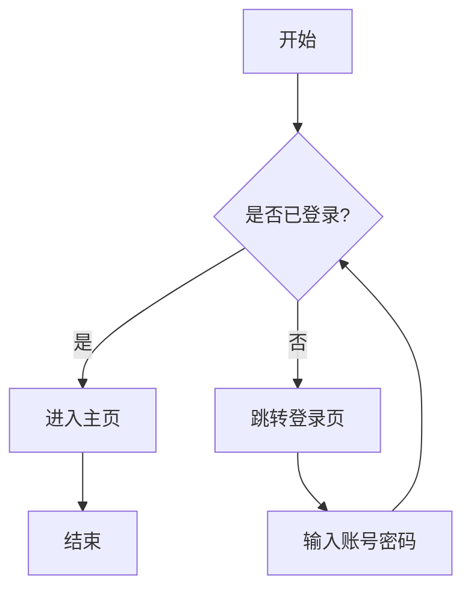

# 项目说明文档

这是一个演示段落，用于展示 **段落** 的层级缩进效果与内联样式清洗。

## 功能列表

- 一级列表项
  - 二级列表项
    - 三级列表项
- 支持有序列表
1. 第一步
2. 第二步

## 任务清单

- [x] 已完成的任务
- [ ] 待办任务
  - [ ] 嵌套待办

## 配图


## 数据表格

| 名称 | 类型 | 说明 |
| --- | --- | --- |
| id | int | 主键 |
| name | str | 名称字段 |

## 代码示例

```python
def hello(name):
    print(f"Hello, {name}!")


def add(a, b):
    return a + b


def main():
    hello("world")
    for i in range(5):
        print(i, add(i, i))


if __name__ == "__main__":
    main()
```

## 流程图



## 引用

> 这是一段引用文字，用于展示引用块的样式效果。

### 三级标题下的内容

普通文本也会随所属标题层级缩进。
